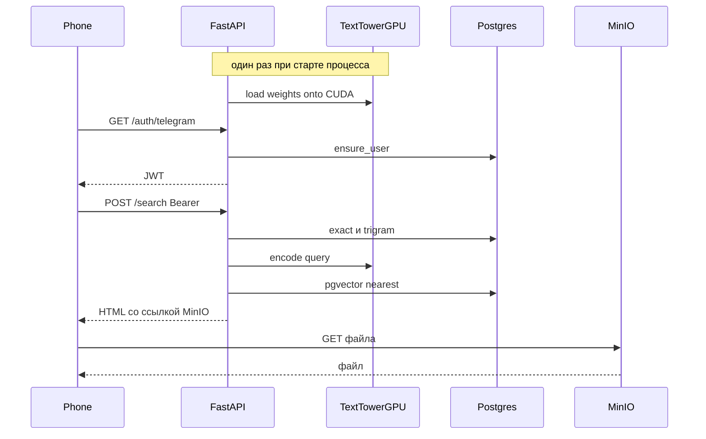

# Миниапп поиска мемов

Отдельное приложение. [`admin_bot`](admin_bot/app.py) не импортируем, его токен, Redis и список админов не читаем.



## Поиск, как он есть

[`SearchService.search`](shared/search/service.py) уже собирает ответ: точная фраза, триграммы OCR, эмбеддинг запроса, pgvector, RRF.

Долгий холодный старт — загрузка текстовой башни. [`ClipTextEncoder.load`](shared/search/clip_text.py) читает веса и оставляет модуль на CPU. Ближайшие картинки ищет Postgres в [`ClipEmbeddingRepository.nearest`](shared/db/repositories/clip_embeddings.py). На GPU башня не ищет по таблице эмбеддингов: таблица остаётся в pgvector.

На один запрос через шину ходят токены (контекст CLIP, 77 int64) и обратно один вектор, 512 float32, 2 КБ. Веса переезжают на GPU один раз в `load()`.

`last_timings` — поле, куда `search()` пишет длительности, чтобы [`scripts/search_memes.py`](scripts/search_memes.py) напечатал их после вызова. В ранжирование оно не входит. Поле удаляем. `search()` на любом пути, включая пустой запрос, возвращает `(hits, timings)`. Скрипт и страница печатают то, что им вернули.

Очередь на башню не ставим. Веса в процессе одни. Запрос добавляет активации одной короткой строки, не вторую копию модели.

Сейчас текстовый `forward` есть только в скрипте: один процесс, один вызов `tower(...)` через `asyncio.to_thread`, процесс заканчивается. Видеобашня — другой процесс, индексатор, и её `forward` тоже один за раз, в одном потоке батча. Миниапп процессов не плодит.

## Башня

Тот же приём, что у [`ClipImageEncoder`](clip_indexer_app/services/encoder.py): аргумент `device`, [`resolve_device`](shared/device.py) и `torch_cuda_available`. В `load()` на устройство уходит уже разрешённое имя `cpu` или `cuda`, не строка `auto`. `encode` требует уже вызванный `load()`. Токены на устройство, вектор обратно через `.float().cpu().numpy()`.

`search_device` лежит в конфиге миниаппа, по умолчанию `auto`. Сервер и скрипт читают его и вызывают `load()` до первого `search()`. Свободную видеопамять не проверяем.

Сервер — один процесс и одна текстовая башня. `uvicorn` без воркеров. Обработчики FastAPI асинхронные: база и выдача ответа идут через `await`. Синхронный в этом пути только `forward`. Его, как и сейчас в [`ClipSearch.encode`](shared/search/clip_search.py), вызываем через `asyncio.to_thread`, чтобы один поиск не останавливал остальные запросы. Одновременные поиски — несколько таких вызовов одного и того же объекта, не новые процессы и не новые копии весов. Скрипт остаётся отдельной командой для проверки. Пока он запущен, у него своя копия башни, потому что это другой процесс. После выхода копия исчезает. Постоянно рядом с сервером он не работает.

## Приложение

Пакет `search_app`, запуск `python -m search_app`. Конфиг — `SearchAppConfig(BaseConfig)`, ключи не читаются из `BaseConfig.__init__` и не обязательны для индексаторов. Скрипт берёт у этого класса только `search_device`. `search_bot_token` и `search_jwt_secret` падают при чтении, если их нет, и читает их только старт сервера. Лог скрипта и сервера — `setup_logging()` на INFO.

Зависимости: `fastapi`, `uvicorn`, `jinja2`, `python-multipart`, `pyjwt`.

Ключи `config.json`:

- `search_device` — `auto`
- `search_host` — `127.0.0.1`
- `search_port` — `8080`
- `search_bot_token` — обязателен при старте сервера
- `search_jwt_secret` — обязателен при старте сервера. Срок JWT 168 часов, алгоритм HS256
- `minio_public_base_url` — публичная база, которую выставляешь сам. Ссылка на файл: `{base}/{file_path}`

Страницы:

- `GET /` — оболочка. Форма скрыта, пока вход не удался.
- `POST /search` — фрагмент в `#results`, `hx-swap="innerHTML"`. Лимит 20. На хит: превью, id, тип, exact, текст OCR, RRF, ранг и скор тех каналов, которые есть в `hit.channels`. Пропавший канал — пустая ячейка, не ошибка. Над списком — тайминги. Пустая выдача — 200 и текст «Ничего не найдено». Ноль хитов и один сработавший канал из трёх оба штатные.
- Превью — `` или `<video controls playsinline webkit-playsinline>` со ссылкой MinIO. Автоплея нет. webm на iOS может не играть, сервер его не перекодирует.
- OCR и остальные тексты хита рендерит Jinja2 с autoescape. Склейки HTML из f-строк нет.

Политику бакета приложение не ставит. Для чтения без записи: [mc anonymous set](https://min.io/docs/minio/linux/reference/minio-mc/mc-anonymous-set.html) с политикой `download`, не `public`. `public` разрешает ещё и запись. На старом `mc`, где нет `anonymous`, та же политика называется `mc policy set download`. `PutBucketPolicy` есть у MinIO много лет, отдельной коммерческой сборки для этого не нужно. Листинг бакета не критичен; запись этой политикой не выдаётся.

Фронт без сборки: HTMX и `telegram-web-app.js`. Цвета из `--tg-theme-*`. Старт как в их `main.tsx`: вызовы только если объект Telegram есть, `disableVerticalSwipes?.()`, `expand()`, `requestFullscreen` в `try` для `ios` / `android` / `android_x`, затем `ready()`.

Пока `GET /auth/telegram` не вернул токен, виден только статус входа. Форма и HTMX-поиск в это время не на экране. Нет `initData` или подпись не сошлась — на этом же статусе текст ошибки, форма так и не появляется. После успеха токен лежит в памяти страницы. `htmx:configRequest` ставит `Authorization: Bearer`. `hx-disabled-elt` на время запроса гасит кнопку. Ожидаемые ответы поиска, включая пустой результат, приходят как HTML со статусом 200, и HTMX их вставляет. На 401 `htmx:beforeSwap` всё же вставляет фрагмент в `#results`, чтобы протухший токен не выглядел мёртвой кнопкой.

## Вход

Образец бэка — [great-dating-app-mvp1-back](https://github.com/pivasikpivtsakov/great-dating-app-mvp1-back): `user/services/telegram_auth_service.py`, `user/router.py`, `user/services/user_service.py`. Клиент — [great-dating-app-mvp1-front](https://github.com/pivasikpivtsakov/great-dating-app-mvp1-front): `src/store/authStore.ts`, `src/config/api.ts`, `src/main.tsx`.

Обмен один раз, до показа формы. Запрос как у axios `params`: `URLSearchParams({init_data})` кодирует строку один раз, сервер читает один query-параметр и делает `parse_qsl`. Второго кодирования и ручной склейки нет: в строке есть `&`, без кодирования FastAPI увидит только кусок до него и подпись не сойдётся.

- Подпись — копия `validate_telegram_hash`. `auth_date` не проверяем.
- Ответ — их `AuthResponse`. Неверная подпись — 401 `Invalid hash - authentication failed`, битый initData — 400. JWT: HS256, `user_id`, `iat`, `exp`, 168 часов.
- `ensure_user`: сначала поиск по `id`. Нет строки — вставка. `IntegrityError` бывает только от гонки двух первых входов одного id. Тогда новая сессия читает эту строку. Лока нет. Повторный вход поля не переписывает. `get_current_user` без строки отвечает 401.

Таблица `users`. Уникальность — первичный ключ `id`. Отдельного индекса по `username` нет: смена username в Telegram иначе сталкивает чужой вход. Приложение схему не меняет. Перед запуском:

```sql
CREATE TABLE users (
    id BIGINT PRIMARY KEY,
    first_name TEXT NOT NULL,
    last_name TEXT,
    username TEXT,
    created_at TIMESTAMPTZ NOT NULL DEFAULT now()
);
```

`POST /search` требует `Authorization: Bearer`. Просрочен, битый или без строки в `users` — 401. Файл мема токеном не закрыт.

HTTPS приложение не терминирует. URL в BotFather указывает на бота с `search_bot_token`.

## Проверка

`uv run ruff check .` и `uv run ty check`. В логе старта на INFO видно `cpu` или `cuda`. Скрипт на том же `search_device` и тоже на INFO. Без валидного `initData` форма не появляется.

## Не делаем

- Связь с админ-ботом, админами, Redis.
- Флаг, выключающий проверку подписи. Токен в `localStorage` и в cookie. Прокси файла, JWT в адресе файла, политика бакета из приложения.
- Проверка `auth_date`. Очередь запросов к башне. Пул воркеров uvicorn. Замер свободной видеопамяти. Проверка при старте, что таблица `users` уже создана.
- Поиск ближайших эмбеддингов на GPU и выгрузка индекса в видеопамять.
- Лимит и язык в интерфейсе, кнопка WebApp в админ-боте, перекодирование webm.
